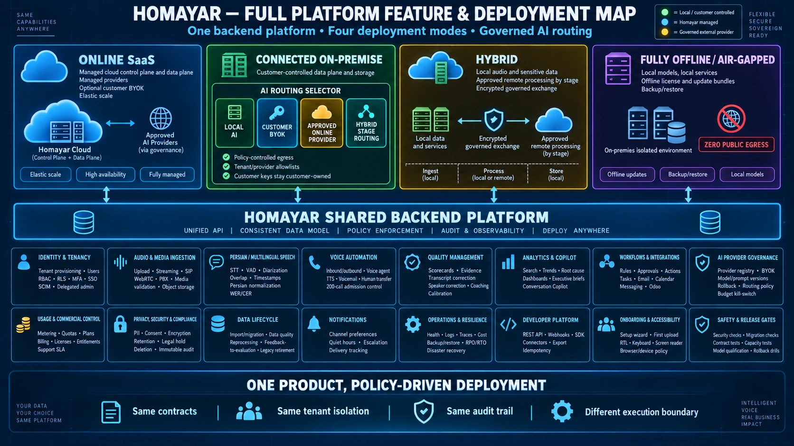

# Homayar — Conversation Intelligence Platform

**One backend platform · Four deployment modes · Governed AI routing**



Homayar is a multi-tenant, Persian-first conversation intelligence platform for
call centers and enterprise customer-service teams. AI agents listen, transcribe,
analyze, score, and coach, and every customer conversation becomes insight.

Built by [KSF Company](mailto:info@ksf.ir).

## One product, policy-driven deployment

The same contracts, tenant isolation, and audit trail run in every mode. Only
the execution boundary changes.

| Mode | Data plane | AI processing |
| --- | --- | --- |
| **Online SaaS** | Homayar Cloud (managed control and data plane) | Approved providers via governance, optional customer BYOK |
| **Connected on-premise** | Customer-controlled data and storage | AI routing selector: local AI, customer BYOK, approved online provider, or hybrid stage routing; policy-controlled egress |
| **Hybrid** | Local audio and sensitive data | Approved remote processing per stage over an encrypted, governed exchange |
| **Fully offline / air-gapped** | Isolated on-premises environment | Local models only, offline license and update bundles, **zero public egress** |

## Platform capabilities

- **Identity and tenancy**: tenant provisioning, RBAC, row-level security, MFA, SSO, SCIM, delegated admin
- **Audio and media ingestion**: upload, streaming, SIP, WebRTC, PBX, media validation, object storage
- **Persian and multilingual speech**: STT, VAD, diarization, overlap, timestamps, Persian normalization, WER/CER
- **Voice automation**: inbound/outbound voice agent, TTS, voicemail, human transfer, call admission control
- **Quality management**: scorecards, evidence, transcript and speaker correction, coaching, calibration
- **Analytics and copilot**: search, trends, root cause, dashboards, executive briefs, conversation copilot
- **Workflows and integrations**: rules, approvals, actions, tasks, email, calendar, messaging, Odoo
- **AI provider governance**: provider registry, BYOK, model and prompt versions, rollback, routing policy, budget kill-switch
- **Usage and commercial control**: metering, quotas, plans, billing, licenses, entitlements
- **Privacy, security, and compliance**: PII redaction, consent, encryption, retention, legal hold, deletion, immutable audit
- **Data lifecycle**: import/migration, data quality, reprocessing, feedback-to-evaluation
- **Operations and resilience**: health, logs, traces, cost, backup/restore, RPO/RTO, disaster recovery
- **Developer platform**: REST API, webhooks, SDK, connectors, export, idempotency
- **Safety and release gates**: security checks, migration checks, contract tests, capacity tests, model qualification, rollback drills

The product contract is [`Homayar/AppVision.md`](Homayar/AppVision.md); boundary
decisions are recorded as ADRs in [`docs/architecture/decisions/`](docs/architecture/decisions/).

## Repository layout

| Path | What it is | Stack |
| --- | --- | --- |
| [`Homayar/backend`](Homayar/backend) | Product backend | FastAPI, SQLAlchemy 2 + Alembic, PostgreSQL (RLS), Celery + Redis, Neo4j projection, local and governed AI providers |
| [`Homayar/frontend`](Homayar/frontend) | Product console | Vite, React 19, TanStack Query, Vitest |
| [`website/`](website/) | Public website (homayar.com) | Next.js 16, OpenNext on Cloudflare Workers |
| [`infra/`](infra/) | Deployment and CI | Compose, Docker, nginx, egress policy, backups, CI checks |
| [`docs/`](docs/) | Architecture, security, operations, research, handoff records | |
| `.claude/` | Shared Claude Code skills and agents for this repo | |

### Product quick start

```bash
cd Homayar
uv sync --frozen
uv run pytest backend/tests -q -rs          # backend tests (SQLite; set TEST_DATABASE_URL for PostgreSQL)
npm --prefix frontend ci && npm --prefix frontend test
```

### Public website

The public site lives in [`website/`](website/). It is deployed to Cloudflare Workers
with OpenNext. See [`website/DEPLOY.md`](website/DEPLOY.md) for setup and release steps.
